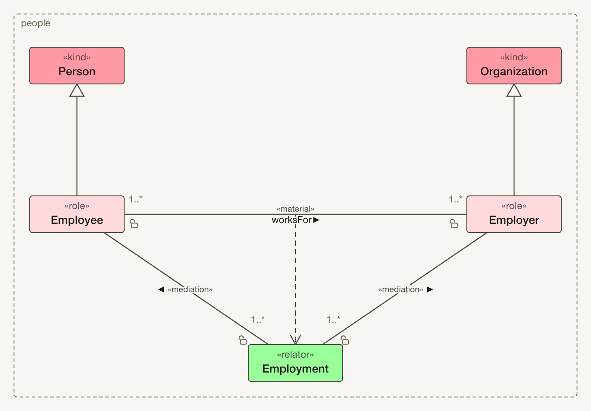

# tonto visualizer: diagrams of tonto models

**tonto visualizer** draws a [tonto](https://github.com/nemo-ufes/tonto) model as an OntoUML class diagram in a panel beside the text. The diagram follows the model as you type it, and you arrange it by hand: drag a class where you want it, and it stays there when the model changes.

The diagram is a reading aid; it edits the saved view, not the model. The Tonto
language supplies semantics such as class natures, parthood, and package
ownership. The extension draws the diagram itself: no PlantUML, no Graphviz, no
rendering server, and nothing sent anywhere.



## Open a diagram

Install the [**tonto** extension](https://github.com/nemo-ufes/tonto), which provides the `.tonto` language, and this one beside it, in VS Code 1.90 or later. Then open a `.tonto` file and run **Tonto: Open Diagram**, or use the diagram button in the editor's title bar or **Open Diagram** in the Explorer's context menu.

The diagram above is the `people.tonto` example from the tonto README:

```tonto
/// People and their employment.
ontology people

/// A person, in the everyday sense.
kind Person

/// A person employed by an organization.
role Employee specializes Person

/// An organization of people.
kind Organization

/// An organization that employs people.
role Employer specializes Organization

/// The employment binding an employee and an organization.
relator Employment {
    @mediation [1..*] -- [1] (const) Employee
    @mediation [1..*] -- [1] (const) Employer
}

@material relation Employee [1..*] -- worksFor -- [1..*] Employer derivedFrom Employment
```

Each class is coloured by the nature its instances have, as the language works it out, and the legend says which colour is which. The padlock marks an end that is *not* `const`: an end that cannot change is the ordinary case, so the exception carries the mark. A multiplicity of `1` is left unwritten, as in a UML diagram.

## Read the model as you write it

| In the panel | What you can do |
|---|---|
| **Live redraw** | The diagram follows each keystroke. While the model does not parse, the last good picture stays up and the problem is reported beside it, not across it. |
| **Navigation** | Double-click a class to open its declaration; moving the cursor in the text selects the element it is on. Double-click a package in an ontology diagram to open that package's class diagram. |
| **Scope and filters** | Draw the open file's packages or the whole workspace, and filter by package, class or association. **Taxonomy only** hides attributes and associations and arranges from inheritance alone. |
| **Display** | Choose straight, curved or right-angled lines, the typeface, and how much space associations get, with **Distance −/+**. **Fit** keeps the whole diagram in view as the panel is resized. |
| **Ontologies** | An ontology file with a `bundles` clause is drawn as a package diagram: its member packages, the ontologies it imports, and the dependencies between them. |

The notation covers stereotypes and attributes, datatypes and enumerations, generalizations and generalization sets (one shared triangle with `{disjoint, complete}`), relation stereotypes and reading direction, whole-part diamonds, `instanceOf`, and `derivedFrom`.

## Arrange it by hand

Drag classes to arrange them; select several with a marquee; pin, align and distribute them. Select a line to show its handles: drag a hollow midpoint to add a bend, drag a solid handle to move one, and press Delete to remove it. **Tonto: Arrange Diagram Automatically** places whatever you have not placed yourself; adding a class never moves the ones you have already arranged. **Tonto: Undo Diagram Change** and **Redo** step through arrangement changes.

Once you change an arrangement, it is saved under the model's `views` folder, as a file you can commit next to the model. **Tonto: Save Diagram as Named View** keeps another arrangement of the same model, such as `views/employment.core-taxonomy.tontoview`, and **Tonto: Open Diagram View** switches between views. When you rename or move a model in VS Code, its views move with it, in the same edit, so undoing the rename puts them back too.

The diagram never edits the model: everything you do in the panel changes only the view.

## Export

**Tonto: Export Diagram as SVG** and **Tonto: Export Diagram as PNG** write the current diagram as it appears, in the typeface it is drawn in, for documents and slides.

## Settings

| Setting | Default | What it does |
|---|---|---|
| `tonto.viz.update` | `onType` | Redraw as the model is typed (`onType`), or only when it is saved (`onSave`). |
| `tonto.viz.followActiveEditor` | `true` | Draw whichever `.tonto` file is open in the editor. Turn this off to keep one diagram on screen while you read elsewhere. |
| `tonto.viz.saveArrangement` | `true` | Save a changed arrangement under the model's `views` folder, so it survives a restart. |

## Acknowledgements

The language, its validation, and the reasoning about natures that colours the diagram are [tonto](https://github.com/nemo-ufes/tonto)'s, from the [NEMO Ontology & Conceptual Modeling research group](https://nemo.inf.ufes.br) at the Federal University of Espírito Santo (UFES), Brazil. See the tonto extension for its full acknowledgements.

## License

MIT. The extension includes code from other open-source packages; their
licenses and notices are in `out/THIRD-PARTY-NOTICES.txt` inside the installed
extension. Among them is the [Eclipse Layout Kernel](https://github.com/kieler/elkjs),
used for automatic layout, which is distributed under the Eclipse Public
License 2.0; that file also says where its source is available.
